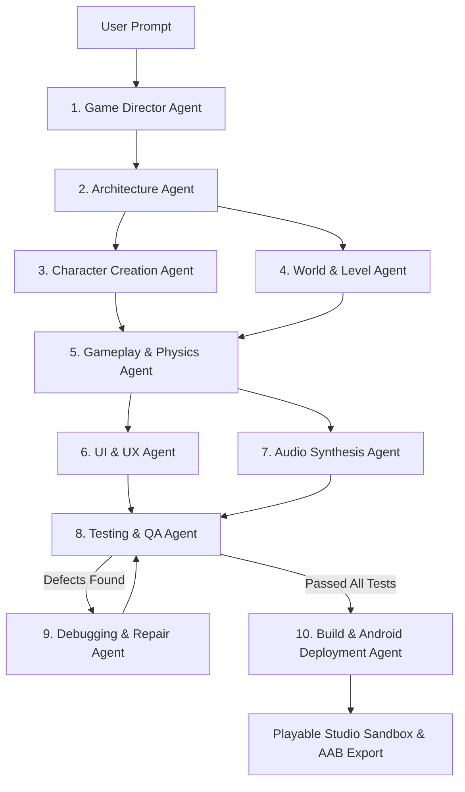

# GameForge AI — Your Imagination. A Playable Reality.

> **Next-Generation Universal AI Game Creation Platform.** Turn natural-language prompts into real, playable 2D, 3D, and board games with autonomous AI agents, continuous surgical editing, automated QA test loops, and 1-click Google Play / Android packaging.

---

## 🚀 Live Overview & Core Capabilities

GameForge AI empowers anyone — from non-programmers to veteran game developers — to describe game ideas in plain English and receive real, executable, tested games.

### 🌟 Key Highlights
- **Real Playable Games (No Simulated Mockups):** Generated projects are executable HTML5 Canvas 2D, Three.js WebGL 3D, and Board Game architectures running in isolated sandboxed iframes.
- **10 Autonomous AI Agents:** Game Director, Architecture, Gameplay & Physics, Character Creation, World & Level, UI/UX, Audio Synthesis, Testing & QA, Debugging & Repair, and Build & Android Deployment.
- **"Edit Anything" Natural-Language Copilot:** Once a game is created, edit mechanics, speeds, abilities, colors, or levels indefinitely. The agent applies surgical AST patches, computes diffs, increments version checkpoints, and hot-reloads without wiping unrelated features.
- **3D Character Studio:** Interactive Three.js 3D viewport with procedural low-poly character geometry, materials, lighting, and live animation state switching (*Idle*, *Walk*, *Jump*, *Attack*).
- **World & Level Editor:** 12x12 interactive tilemap painter with biomes (*Emerald Forest*, *Neon Cyberpunk*, *Solar Desert*, *Floating Islands*, *Volcanic Dungeon*), procedural generator, weather, and gravity controls.
- **Automated Testing & Auto-Repair (Test E):** 7 headless and runtime test suites. Includes an interactive controlled error injection demonstrator where the QA Agent detects syntax/logic faults and the Repair Agent automatically investigates, patches, and rebuilds.
- **Google Play Store & Android Packager:** Generates valid `AndroidManifest.xml` (Target SDK 34), `build.gradle`, `capacitor.config.json`, store listing metadata, and downloadable `.zip` bundles ready for Google Play Console submission.

---

## 🎮 Included Verified Milestones & Acceptance Test Games

GameForge AI includes five pre-built, production-grade showcase projects satisfying all prompt acceptance criteria:

1. **Royal Snakes & Ladders (Test A - Board Game):**
   - 2-player local turn management (Red Hero vs Blue Rival).
   - Authentic 100-cell serpentine board.
   - 3D-styled animated dice tumbling physics.
   - 10 functional snakes with slide-down animations and 9 climbable ladders.
   - Win condition check at tile 100 with celebration modal and restart.

2. **Neo Runner 2D: Cyber Rush (Test B - 2D Arcade Game):**
   - Side-scrolling retro platformer with double jump kinematics.
   - Hero character sprite with glowing cyber visor and jet boots.
   - Collectible plasma gems with sparkle particles and multiplier score system.
   - Moving laser gates and spike hazards with precise AABB collision detection.
   - 3 milestone progression levels (*Neon Roofs*, *Rooftop Ascent*, *Cyber Matrix*).
   - Web Audio procedural sound synthesizer.

3. **Solaria: Sun Island 3D (Test C - 3D Adventure Game):**
   - Real Three.js 3D world with floating islands, ancient archway ruins, and dynamic shadows.
   - 3rd-person spring-arm follow camera with WASD / touch joystick controls.
   - Interactive NPC **Elder Aven** with proximity detection and branching dialogue quests.
   - 5 spinning Solar Crystals scattered across traversable islands.
   - Celestial Sun Gate awakening event with golden light pillar on quest completion.
   - Dynamic Day / Night cycle toggle.

4. **Galactic Defense: Void Strike (2D Space Combat):**
   - Twin-cannon plasma lasers with fire-rate governor.
   - Shield health meter with defensive buffering.
   - Sine-wave enemy squadron flight AI and explosion particles.
   - Mothership Boss battle with multi-phase health bar.

5. **Cyberpunk Odyssey (Test G - Open-World Prototype):**
   - Modular city district with roads, sidewalks, and neon skyscrapers.
   - Dual locomotion state machine: Foot exploration OR Cyber-Car driving mode (`[F]` to enter/exit with vehicle acceleration, friction, and steering).
   - Walking pedestrian citizen AI with patrol routines.
   - Interactive Cyber-Bazaar Item Shop with credits economy.
   - Mission Terminal with data delivery contracts and minimap radar.
   - Dynamic Cyber-Rain weather simulation toggle (`[T]`).

---

## 🛠️ Tech Stack & Architecture

- **Frontend Framework:** React 19 + TypeScript + Vite.
- **Styling:** Pure Vanilla CSS with bespoke design tokens, soft neutral light theme, crisp Inter & Outfit typography, and glassmorphism.
- **3D Graphics Engine:** Three.js (r128) with PCFSoftShadowMap and procedural geometry.
- **Audio:** Web Audio API Procedural Sound Synthesizer (zero broken external URL dependencies).
- **Packaging:** JSZip for binary zip generation of offline web releases and Android Gradle projects.
- **Icons:** Lucide React.

---

## 📦 Getting Started Locally

### 1. Prerequisites
- Node.js (v18+ recommended, verified on v24)
- npm (v9+)

### 2. Installation
```bash
# Clone or open repository
cd GameForge-AI

# Install dependencies
npm install

# Start development server
npm run dev
```

Open your browser at `http://localhost:5173/`.

### 3. Production Build
```bash
npm run build
npm run preview
```

---

## 🤖 The 10 Autonomous AI Agents



1. **Game Director Agent:** Semantic intent analysis, core gameplay loop design, feature dependency graph.
2. **Architecture Agent:** Engine adapter selection (`canvas-2d`, `three-3d`, `board-engine`), resolution, and frame budget.
3. **Character Creation Agent:** Original character profile, stats, abilities, lore, and 3D procedural meshes.
4. **World & Level Agent:** Terrain matrices, platforms, hazards, biomes, day/night lighting, and weather.
5. **Gameplay Agent:** Kinematic controller, spatial collisions, state machines, win/loss triggers.
6. **UI & UX Agent:** Glassmorphism HUD, health meters, minimaps, dialog overlays, and virtual touch controls.
7. **Audio Agent:** Web Audio procedural oscillator synthesizers for SFX (jump, coin, laser, hit, victory).
8. **Testing Agent:** Automated headless suite executing AST syntax check, canvas initialization, input bindings, collision math, and win state reachability.
9. **Debugging & Repair Agent:** Computes minimal AST and regex code patches to fix detected issues and reruns tests.
10. **Build & Android Deployment Agent:** Bundles runnable offline web packages and generates complete Android Google Play packages with `AndroidManifest.xml`.

---

## 📱 Google Play Publishing Workflow

1. In GameForge AI, open **Export & Android** in the navbar.
2. Configure App Title, Package Identifier (e.g. `ai.gameforge.mygame`), and versioning.
3. Click **Download Android Release Package**.
4. The downloaded package contains:
   - `app/src/main/AndroidManifest.xml` (Target SDK 34, required permissions, orientation, hardware acceleration)
   - `app/build.gradle` (Application ID, compileSdk, dependencies)
   - `capacitor.config.json`
   - `google_play_metadata.json` (Short description, full description, content rating, privacy policy URL)
   - `PLAY_STORE_PUBLISH_GUIDE.md`
5. Run `./gradlew bundleRelease` to generate `app-release.aab` and upload to Google Play Console.

---

## 🛡️ Security & Privacy
- Zero credentials or secrets exposed in browser code.
- Generated games execute within isolated sandboxed iframes (`sandbox="allow-scripts allow-modals allow-pointer-lock allow-same-origin"`).
- All project data and checkpoints persist safely in the user's local storage with export/import support.

---

*Built with passion by the GameForge AI Product & Engineering Team.*
